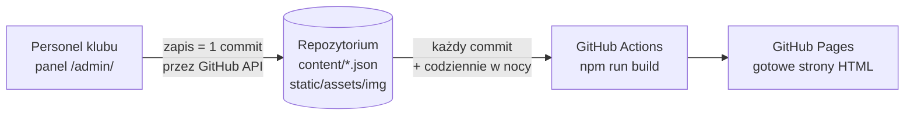

# Harris Piano Jazz Bar — strona i panel treści

Strona klubu ([harris.krakow.pl](https://harris.krakow.pl/)) zbudowana w **SvelteKit 3** jako gotowy HTML (prerender, bez JavaScriptu frameworka na stronach publicznych) oraz **panel treści `/admin/`** do zmieniania koncertów, tekstów, zdjęć i kart menu bez programisty.

## Jak to działa



- Cała treść jest w plikach `content/*.json`; zdjęcia w `static/assets/img/`.
- Panel zapisuje zmiany jednym commitem (pliki JSON + nowe/usunięte zdjęcia). Przed zapisem sprawdza, czy nikt inny nie zmienił tych samych plików.
- Po każdym commicie GitHub Actions buduje stronę i publikuje ją w ok. 1–2 minuty. Codziennie w nocy strona buduje się ponownie, żeby z programu znikały minione koncerty (dodatkowo ukrywa je w przeglądarce `events.js`).

## Panel treści (`/admin/`)

| Zakładka | Co zmienia |
| --- | --- |
| Koncerty | program: dodawanie, edycja, powielanie na kolejny tydzień, usuwanie; każdy koncert ma własną stronę `/koncerty/<adres>/` |
| Teksty strony | SEO (z licznikiem znaków), nagłówek ze zdjęciem, pasek, koncerty, O nas, liczby, galeria, menu, rezerwacja, „Znajdź nas”, stopka — PL i EN |
| Godziny i kontakt | telefon, e-maile (także adres rezerwacji), adres, linki, godziny otwarcia (też dla Google) |
| Pytania (FAQ) | pytania i odpowiedzi (te same trafiają do danych FAQ dla Google) |
| Galeria | wgrywanie zdjęć (automatyczna konwersja do WebP 1600 px + 480 px), opisy PL/EN (wymagane), kolejność, usuwanie |
| Karty menu | okładka i strony karty oraz karty win, kolejność stron |
| Grali u nas, Partnerzy, Polityka prywatności | listy i teksty tych sekcji |

**Logowanie:** token GitHub (fine-grained) z dostępem tylko do tego repozytorium i uprawnieniem *Contents: Read and write*. Instrukcja jest na ekranie logowania. Każdy edytor potrzebuje konta GitHub z dostępem do repozytorium.

## Pierwsze uruchomienie (jednorazowo)

1. **Settings → Pages → Build and deployment → Source: GitHub Actions.**
2. Własna domena (gdy klub przeniesie stronę): **Settings → Secrets and variables → Actions → Variables** → `CUSTOM_DOMAIN` = `harris.krakow.pl`, a w DNS rekord CNAME na `wiksas.github.io`. Bez tej zmiennej strona działa pod `https://wiksas.github.io/strona02/`.
3. Edytorom: dodać ich konta GitHub jako współpracowników repozytorium (Settings → Collaborators).

## Praca lokalna

```bash
npm ci
npm run dev        # http://localhost:5173/ (panel: /admin/)
npm run build      # gotowa strona w build/
npm run check      # kontrola typów
BASE_PATH=/strona02 npm run build   # wersja pod adresem github.io
```

Wymagany Node ≥ 22.17.

## Struktura

| Ścieżka | Rola |
| --- | --- |
| `content/` | treść strony (edytowana w panelu) |
| `src/routes/(site)/` | strony publiczne: `/`, `/en/`, `/koncerty/`, `/en/concerts/`, strony koncertów, polityka prywatności, `404.html`, `sitemap.xml` |
| `src/routes/admin/` | panel treści (aplikacja w przeglądarce) |
| `src/lib/components/` | elementy stron publicznych |
| `src/lib/admin/` | panel: klient GitHub API, stan, konwersja zdjęć, sekcje, style |
| `src/lib/seo.js` | dane strukturalne (WebSite, BarOrPub, WebPage, FAQPage, MusicEvent) |
| `src/lib/i18n.js` | stałe napisy interfejsu PL/EN i adresy podstron |
| `src/lib/config.js` | adres strony, repozytorium, wersja CSS/JS (`ASSET_VERSION`) |
| `static/assets/` | CSS, `main.js` (interakcje), `events.js` (ukrywanie minionych koncertów), czcionki, zdjęcia, ikony |
| `static/_redirects` | przekierowania 301 ze starej strony WordPress (dla hostingu Netlify / Cloudflare Pages) |
| `.github/workflows/deploy.yml` | budowanie i publikacja |

Po zmianie plików w `static/assets/css` lub `static/assets/js` podbij `ASSET_VERSION` w `src/lib/config.js`.

## Uwagi

- **GitHub Pages nie obsługuje przekierowań** ze starych adresów WordPressa (`/koncert/…`, `/kalendarz/` itd.). Przy przenoszeniu domeny trzeba je ustawić u hostingu/DNS albo opublikować `build/` na Netlify / Cloudflare Pages, które czytają `static/_redirects`.
- Koncerty zostały zaimportowane z kalendarza WordPress (stan na 6.11.2026). Stary kalendarz nie jest już używany przez stronę.
- Formularz rezerwacji otwiera program pocztowy z gotową wiadomością na adres z „Godziny i kontakt”.
